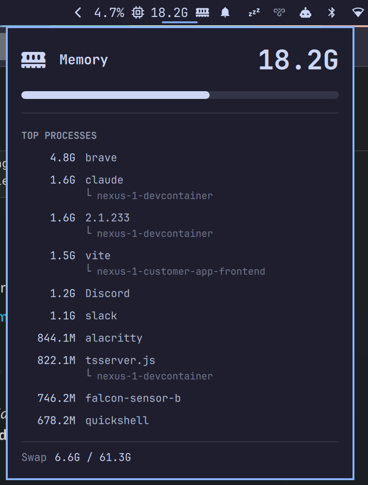

# Omatop

An Omarchy bar widget that shows CPU or memory usage and, in its popup, which
processes are actually eating it.

- **Per-process breakdown** — the top consumers, aggregated by process name, right in the bar popup
- **Docker-aware** — processes inside containers show the container name underneath
- **Smart process names** — resolves unhelpful names like `MainThread`, Nix wrappers, and generic interpreters to the real application
- **Themed** — colors, font, and popup chrome come from the shell theme, so it matches the rest of the bar



This is the Omarchy-shell port of
[waybar-top-cpu-mem](https://github.com/twiking/waybar-top-cpu-mem).

## Install

```bash
omarchy plugin add https://github.com/twiking/omarchy-omatop.git
omarchy plugin enable io.github.twiking.omatop
```

The widget lands in the bar's right section; move it with `omarchy bar move`.

It is a single-metric widget, so add it twice — once with `metric: "cpu"` and
once with `metric: "memory"` — to get both, the way the two Waybar modules
worked.

## Settings

Settings live in the widget's `shell.json` layout entry:

| Key | Type | Default | What it does |
|---|---|---|---|
| `metric` | `"cpu"` \| `"memory"` | `"cpu"` | Which resource this instance tracks |
| `processCount` | integer 1–20 | `10` | How many processes the popup lists |
| `refreshIntervalSec` | integer 1–60 | `3` | How often stats are sampled |
| `showLabel` | boolean | `true` | Show the value next to the icon (horizontal bars only) |

```json
{
  "bar": {
    "layout": {
      "right": [
        { "id": "io.github.twiking.omatop", "metric": "cpu" },
        { "id": "io.github.twiking.omatop", "metric": "memory", "processCount": 8 }
      ]
    }
  }
}
```

## Interactions

- **Left click** — open/close the popup
- **Right click** — launch or focus `btop`
- **Esc** — close the popup

## How it works

`bin/omatop-stats <cpu|memory> [count]` collects everything in one shot and
prints line-based TSV; `Panel.qml` polls it on a timer and `Model.js` parses it.
Running the script by hand is the fastest way to debug a wrong-looking number.

### CPU

CPU usage is normalized across all cores to a 0–100% scale (matching tools like
btop). `top` in batch mode measures percentages and `ps` resolves process names;
the two are joined by PID.

### Memory

Memory is aggregated per process name using RSS from `ps`, so multiple instances
of the same program (browser tabs, workers) are summed into one row. The bar
label shows used memory in GB; the usage bar shows the percentage of total RAM.

### Process name resolution

Both metrics handle cases where the reported process name is unhelpful:

- `MainThread` (Python apps) — resolved from the command line
- `.foo-wrapped` / `.foo-wrap` (Nix wrappers) — resolved to the actual binary name
- Generic interpreters (`node`, `python`, `bash`, etc.) are skipped in favor of the actual script or app name

### Docker detection

Processes running inside Docker containers are detected via cgroup membership
(`/sys/fs/cgroup/system.slice/docker-*.scope`) and matched against
`docker ps`. The container name is shown below the process row. With no Docker
on the system, this step is skipped entirely.

## Development

```bash
omarchy plugin validate "$HOME/.config/omarchy/plugins/io.github.twiking.omatop"
qmllint -I "$OMARCHY_PATH/shell" Panel.qml
```

## License

MIT — see [LICENSE](LICENSE).
